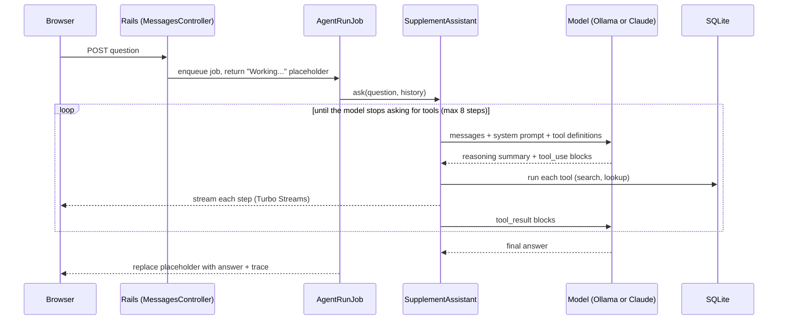

# Supplement Agent

A Ruby on Rails app with an AI agent that answers questions about supplements and
products. It works from a small knowledge base, calls tools that query the app's own
database, and shows each step it took to reach an answer.

Ask *"I take warfarin. Is fish oil OK?"* and the agent will:

1. search the knowledge base for omega-3 information,
2. check the interactions table for fish oil + warfarin,
3. answer with citations (`KB #3`) and a pointer to a pharmacist, and
4. show the reasoning, each tool call and its result in a collapsible panel.

Steps appear in the browser while the agent is still working.

The model is pluggable. It runs **for free on a local model** (Qwen3 8B through
[Ollama](https://ollama.com)) or on **Claude** through the Anthropic API. You switch
between them with one setting.

> All products and brands are fictional. The knowledge base is a set of short summaries
> written for this demo (sources noted on each article). This is general information,
> not medical advice.

## How it works



### The agent loop

[`app/agents/supplement_assistant.rb`](app/agents/supplement_assistant.rb) is a
hand-written tool-use loop:

1. Send the conversation, a system prompt and three tool definitions to the model.
2. If the model asks for tools (`stop_reason` is `tool_use`), run every requested tool
   and send all the results back in **one** message.
3. Repeat until the model answers in plain text, refuses, or hits the step limit.

I wrote the loop by hand rather than using an SDK helper so every step is visible:
that's what feeds the reasoning trace, and it's where the error handling lives (bad
tool input becomes an `is_error` result the model can recover from, instead of a crash).

### Pluggable model providers

The agent talks to the model through one method, `chat(system:, messages:, tools:)`,
defined in [`app/agents/llm.rb`](app/agents/llm.rb). There are two providers:

| Provider | Class | Cost | Notes |
|---|---|---|---|
| `ollama` (default) | [`Llm::OllamaProvider`](app/agents/llm/ollama_provider.rb) | Free, runs on your machine | Qwen3 8B by default; uses Ollama's `/api/chat` over plain `Net::HTTP` |
| `anthropic` | [`Llm::AnthropicProvider`](app/agents/llm/anthropic_provider.rb) | Paid API | Claude via the official `anthropic` gem; summarized thinking, prompt caching, refusal fallbacks |

Internally the conversation always uses one message format (Claude's content blocks:
`text`, `thinking`, `tool_use`, `tool_result`). The Ollama provider translates to and from
Ollama's format: tool calls become `tool_calls` on the assistant message, each tool
result becomes a `role: "tool"` message, and since Ollama doesn't give tool calls ids,
the provider generates them so calls and results still pair up. Because of this, the
agent loop, tools, trace and UI are identical whichever model is answering.

### Tools

| Tool | What it does | Backed by |
|---|---|---|
| `search_knowledge_base` | Keyword search over short articles on forms, doses, timing and safety | `Article` |
| `search_products` | Catalog lookup with optional max price and in-stock filters | `Product` |
| `check_interactions` | Known interactions between two or more supplements or drug classes | `Interaction` |

Each tool is a small class in [`app/agents/tools/`](app/agents/tools) with a name, a
description written for the model, a JSON Schema and a `#call` method. Adding a tool
means adding one class and listing it in `SupplementAssistant::TOOLS`.

### Showing the reasoning

The trace has four kinds of step:

- **Reasoning**: the model's thinking. Qwen3 returns it through Ollama's `think` option;
  Claude returns a summary (`thinking: { type: "adaptive", display: "summarized" }`).
- **Tool call**: the tool name and the exact input the model chose.
- **Tool result**: a one-line summary, expandable to the raw JSON the model received.
- **Answer**: how the run ended (done, refused, truncated or step limit) and which model answered.

Steps stream to the page through Action Cable / Turbo Streams as they happen, and are
saved on the message so they're still there after a reload.

### Conversation memory

Each conversation stores the full API transcript (`api_messages`), including tool
calls, tool results and thinking blocks, and sends it back on the next question. That's
what makes follow-ups like *"is the second one cheaper?"* work.

## Running it

Requirements: Ruby 3.2+ (developed on Ruby 4.0 and Rails 8.1).

### Free, with a local model (default)

Needs about 6 GB of disk and 16 GB of RAM is comfortable.

```bash
brew install ollama            # or download the app from https://ollama.com
ollama serve                   # leave this running in its own terminal tab
ollama pull qwen3:8b           # one-time ~5 GB download
```

```bash
git clone <this repo> && cd supplement-agent
bundle install
cp .env.example .env           # LLM_PROVIDER=ollama is already set
bin/rails db:setup             # creates the SQLite database and loads the seed data
bin/dev                        # Rails + Tailwind watcher on http://localhost:3000
```

Each step takes roughly 10 to 20 seconds on an Apple M4, so a full answer can take
30 to 60 seconds.

### With Claude

In `.env`, set `LLM_PROVIDER=anthropic` and paste your key from the
[Anthropic Console](https://console.anthropic.com/) into `ANTHROPIC_API_KEY`. Answers are
faster and more reliable at following the citation and grounding rules. To keep costs
down, set `ANTHROPIC_MODEL=claude-haiku-5-5`.

Try the example questions on an empty conversation, or ask things like:

- "Which magnesium is best for sleep, and do you have one in stock?"
- "I'm vegan. What B12 and omega-3 options are under $20?"
- "Can I take iron and calcium together?"
- "I'm on levothyroxine. Anything I should know about calcium or iron?"

## Tests

```bash
bin/rails test
```

The tests call no model at all. `test/support/fake_anthropic_client.rb` returns scripted
responses built from the Anthropic SDK's real response classes, and the Ollama tests use a
fake HTTP object. Both record every request, so the tests check what the agent actually
sends:

- each tool's search and filtering, and that bad input raises a recoverable error
- the loop runs tools, returns all results in one message, and passes thinking blocks back unchanged
- earlier turns are included for follow-ups
- unknown tools and bad input become error results, not crashes
- the step limit and refusals are handled
- the job saves the answer and trace, and shows a clear message on a bad API key
- a second question can't start while the first is still running
- the Ollama provider translates tool calls, tool results and thinking in both directions,
  and a stopped Ollama server gives a clear "start `ollama serve`" message

## Project layout

```
app/agents/supplement_assistant.rb   the agent loop and system prompt
app/agents/tools/                    one class per tool
app/agents/llm.rb, app/agents/llm/   the model providers (Ollama, Claude)
app/jobs/agent_run_job.rb            runs the agent in the background, streams steps
app/models/                          Product, Article, Interaction, Conversation, Message
app/models/concerns/keyword_searchable.rb   the small search used by two tools
app/views/messages/_step.html.erb    how each trace step is drawn
db/seeds.rb                          the knowledge base, catalog and interactions
```

## Design choices

- **SQLite and keyword search.** The knowledge base is a few dozen rows, so a weighted
  keyword match is enough and the app runs with no extra services. Search is isolated
  in one module, so moving to full-text search or embeddings wouldn't change the tools.
- **Provider interface instead of one vendor's SDK everywhere.** The loop depends on a
  single `chat` method, so the project runs free during development and can switch to a
  stronger hosted model without touching the agent, tools or UI.
- **Background job + Turbo Streams.** An agent run takes several model calls. Running it
  in a job keeps the web request fast and lets the page show progress live.
- **Grounding over general knowledge.** The system prompt tells the agent to search
  before answering, cite what it used, only recommend products the catalog returned, and
  check interactions whenever more than one substance or any medication comes up.
- **Safety defaults.** Pregnancy, prescriptions, chronic conditions and children are
  routed to a practitioner; an empty interaction result is described as "none recorded",
  not "safe"; refusals are handled, and server-side fallbacks are enabled.

## Known limitations

- The 8B local model follows instructions less reliably than Claude: it sometimes skips
  a knowledge base search when the interactions database already answered, or writes
  citations in its own format. The system prompt narrows this, but doesn't remove it.
- Keyword search matches any term, so a query like "omega-3 vegan" can also return vegan
  B12 products. The model usually filters these out in its answer.

## What I'd add next

- An evaluation set: 20-30 questions with expected tool calls and facts, run against
  both providers to compare the local model with Claude.
- Embedding-based search for questions phrased differently from the articles.
- Token and cost tracking per answer, shown in the trace.
- A product comparison tool, and links from citation badges to the article or product.
